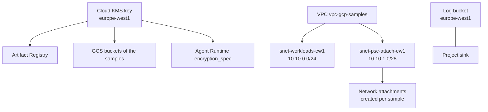

# 🏗️ base — shared foundations

Terraform documentation: [TFDOCS.md](TFDOCS.md)

Common resources consumed by every GEAP sample through `terraform_remote_state`: one CMEK key, a private Belgium VPC, a regional log bucket, a Docker repository and a budget.

## ✨ Features

- Single Cloud KMS key in `europe-west1` (90-day rotation, `prevent_destroy`).
- Custom-mode VPC `vpc-gcp-samples` with a workloads subnet and a subnet reserved for PSC interface network attachments.
- Logs kept in Belgium (regional bucket) with the global `_Default` sink excluded.
- CMEK-protected Artifact Registry repository (immutable tags).
- Budget alerts at 50 / 90 / 100 % (optional): billing account from `TF_VAR_billing_account`, else the one linked to the project when readable, else disabled.

## 🧭 Architecture



### Key Design Decisions

| Decision | Choice | Why |
|---|---|---|
| Region | `europe-west1` only (`validation {}` enforced) | Data sovereignty |
| Encryption | One CMEK key shared by all samples | Single point of control and rotation |
| Egress | No NAT, no external IP | No internet path by design; Private Google Access for Google APIs |
| Logs | Regional bucket + exclusion on `_Default` | Application logs stay in Belgium (`_Required` audit logs remain global) |
| Service agents | Base grants GCS, Artifact Registry and Agent Platform agents on the key (30 s wait for IAM propagation); `extra_cmek_service_agents` adds more (e.g. the Agent Runtime agent); Cloud Run/Functions agents are granted by `geap-agent-secured` | One owner per key binding: samples never share an IAM binding |

## 🔒 Security Design

- Explicit logged deny-all ingress firewall rule (priority 65000); samples add narrow allow rules, with ports commented.
- KMS bindings are resource-level (on the key), never project-wide.
- Terraform state lives in a versioned bucket with uniform access and public access prevention (`task bootstrap`).

## 💰 FinOps

| Item | Estimate | Note |
|---|---|---|
| Cloud KMS key | ~0.06 USD / key version / month | Rotation adds a version every 90 days |
| VPC, subnets, firewall | 0 | Flow logs sampled at 50 %, ingested in the regional log bucket |
| Artifact Registry | storage only | Untagged images cleaned after 30 days |
| Log bucket | free allotment then per GiB | Retention 30 days by default |

> [!TIP]
> No Cloud NAT is provisioned (about 30 USD/month saved); nothing in the samples needs internet egress.

## 📋 Prerequisites

`task setup`, a filled `.env` (see the root `.env.example`), `gcloud auth application-default login`, and `task bootstrap` at the repository root.

## 🚀 Deployment

```bash
task plan      # from samples/base, or: task base:plan from the root
task apply
```

> [!WARNING]
> The KMS key and key ring cannot be deleted from Cloud KMS. `prevent_destroy` blocks `task destroy`: remove the key from the state first if you really want to tear everything down.

## 🧰 Task Commands

| Command | Description |
|---|---|
| `task init` | Initialise Terraform with the GCS backend |
| `task plan` | Plan the base stack |
| `task apply` | Apply the saved plan (billable) |
| `task destroy` | Destroy the stack (see the warning above) |
| `task validate` | Validate without backend or credentials |
| `task test` | Offline Terraform tests (mock providers) |
| `task docs` | Regenerate `TFDOCS.md` |

## 🗂️ Project Structure

```text
samples/base/
├── main.tf               # terraform block, providers, API activation, labels
├── backend.tf            # GCS backend (bucket injected at init)
├── variables.tf  outputs.tf
├── kms.tf                # shared CMEK key + service agent bindings
├── network.tf            # VPC, subnets, deny-all ingress
├── logging.tf            # regional log bucket and sink
├── artifact_registry.tf  # Docker repository (CMEK)
├── budget.tf             # billing budget (optional)
├── tests/base.tftest.hcl # offline tests
└── Taskfile.yml
```
