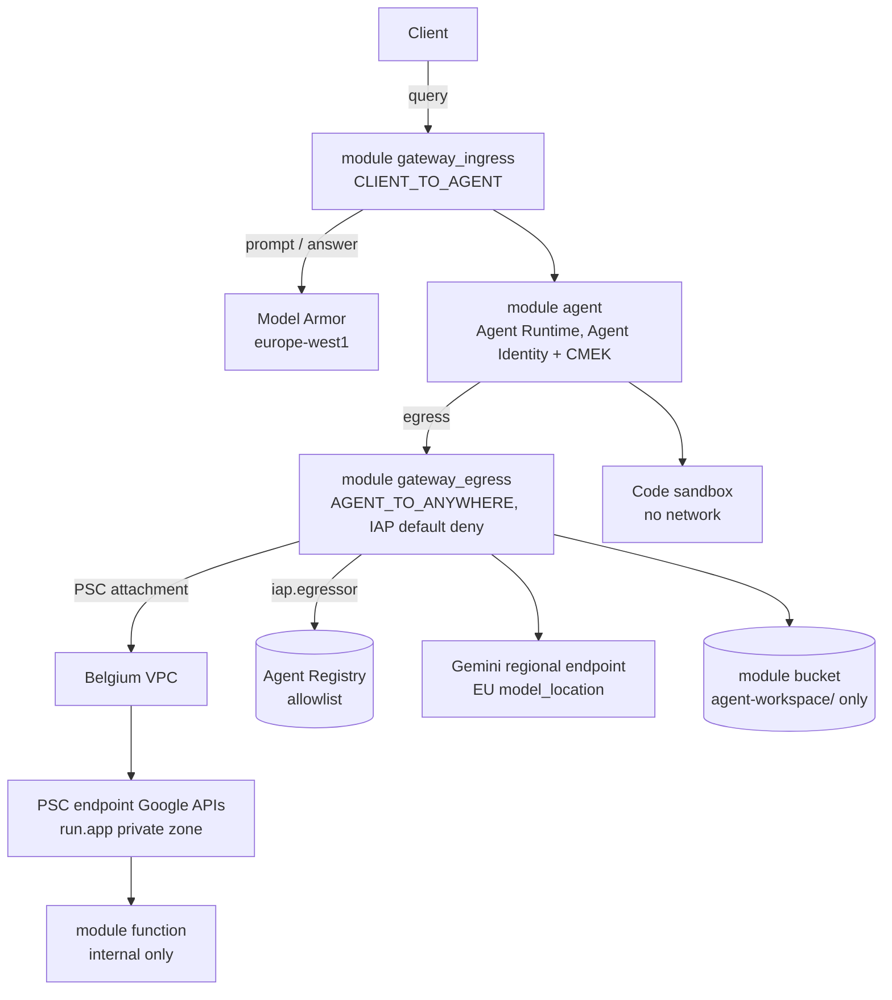

# 🛡️ geap-agent-secured — governed agent built on Cloud Foundation Fabric

Terraform documentation: [TFDOCS.md](TFDOCS.md)

Secured agent built on the [Cloud Foundation Fabric](https://github.com/GoogleCloudPlatform/cloud-foundation-fabric) modules: an ADK agent on **Agent Runtime** that answers a simple question, reads and writes **one path** of a bucket, triggers a **Cloud Run function** and runs code in a **sandbox**, behind two **Agent Gateways** (Model Armor on the way in, default-deny IAP allowlist on the way out), with **Agent Identity**, CMEK and a private attachment to the Belgium VPC.

> [!WARNING]
> This sample provisions billable resources (two Agent Gateways, Agent Runtime, Model Armor, a code sandbox). Read the FinOps section, then run `task destroy` after a demo.

> [!IMPORTANT]
> A project gets **two Agent Gateways per region** (`RegionalAgentGateways` quota, limit 2 in `europe-west1`), and every Agent Runtime engine of a project and region must bind to the same gateways. A second secured sample therefore cannot be deployed next to this one.

## ✨ Features

- Agent Identity, CMEK; every resource in `europe-west1`, model inference in an EU region (`europe-west3` by default, `model_location`).
- Ingress gateway (`CLIENT_TO_AGENT`) with Model Armor screening prompts and answers.
- Egress gateway (`AGENT_TO_ANYWHERE`), **default deny**: IAP is the gateway authorizer; only endpoints registered in Agent Registry and granted `roles/iap.egressor` are reachable.
- Bucket access restricted to the `agent-workspace/` managed folder.
- Backend Cloud Run function (internal ingress, dedicated service accounts), reached from the egress gateway through the VPC (DNS peering on `run.app.` → PSC endpoint for Google APIs of `samples/base`).
- Sandboxed code execution through `AgentEngineSandboxCodeExecutor`, on a sandbox provisioned by `task sandbox`.
- Optional semantic governance policy (Preview).

## 🧱 Cloud Foundation Fabric modules

Every module is pinned to commit [`25d8d9a`](https://github.com/GoogleCloudPlatform/cloud-foundation-fabric/tree/25d8d9a0ca869fd15083a16183f61de1408524e3) of `master` (2026-10-09): release `v59.0.0` sets `dns_peering_config.domain`, which the `google` 8.5 provider rejects, and no tag contains the fix yet ([ADR 005](../../docs/adr/005-cloud-foundation-fabric-modules.md)).

| Module | Resources | File |
|---|---|---|
| `geap-agent-gateway` ×2 | Agent Gateways, connectivity template (egress), IAP authz extension + `REQUEST_AUTHZ` policy (egress), Model Armor authz extension + `CONTENT_AUTHZ` policy (ingress) | `gateway.tf` |
| `geap-agent-runtime` | Reasoning engine (source deployment, Agent Identity, CMEK, gateway binding, `deletion_policy = FORCE`), project roles of the agent identity | `agent.tf` |
| `gcs` | Data bucket, `agent-workspace/` managed folder and its IAM | `storage.tf` |
| `cloud-function-v2` | Function, runtime service account, source bundle, `run.invoker` binding | `function.tf` |
| `iam-service-account` | Build service account and its Cloud Build role | `function.tf` |

Raw resources remain where Fabric has no module, or cannot take the value at plan time: Agent Registry services and the per-endpoint `roles/iap.egressor` grants (`registry.tf`), Model Armor templates (`model_armor.tf`), the network attachment (`network.tf`), semantic governance (`policies.tf`).

## 🧭 Architecture



### Key Design Decisions

| Decision | Choice | Why |
|---|---|---|
| Terraform modules | Cloud Foundation Fabric, pinned by commit SHA | Second attempt at the secured sample on maintained GEAP modules ([ADR 005](../../docs/adr/005-cloud-foundation-fabric-modules.md)) |
| Gateway providers | The `geap-agent-gateway` module configures its own provider (`networkservices` v1alpha1) | Module design: provider `default_labels` do not reach it (labels passed explicitly), no `depends_on`/`count`/`for_each` on it, and `mock_provider` does not reach it (offline tests use `override_module`) |
| Network attachment | Passed through the module `context` (`$psc_network_attachments:egress`) | The module counts its connectivity template on `psc_i_network_attachment_id`: a literal context key is known at plan time, the attachment id is not |
| Egress grants | Raw `google_iap_agent_registry_endpoint_iam_member`, one per endpoint | The module infers each binding type from which id is set; an endpoint id generated by Agent Registry leaves its `for_each` keys unknown at plan. Its whole-registry `registry_iam` would also open the endpoints registered by other samples |
| Ingress authorization | `iap_config = null`, Model Armor only, fail closed | Same behaviour as `geap-agent-secured` ([ADR 003](../../docs/adr/003-model-armor-at-gateway.md)) |
| Agent roles | `service_account_config.roles` of the runtime module, bound to the agent identity | Least privilege: the module default would add `storage.objectViewer` on every bucket of the project |
| Engine deletion | `enable_deletion_protection = false` (`deletion_policy = FORCE`) | The API refuses to delete an engine with child resources (sessions, sandbox) unless `force=true` |
| Sandbox | Pre-provisioned by `task sandbox`, found by display name before each run (`session.state["sandbox_name"]`) | Same code as `geap-agent-secured`, whose engine never completed a creation operation. On this engine the native creation completes in 5 to 6 s (2026-10-09), so the per-session fallback of the executor works too |
| Shared IAM | CMEK grants of the Cloud Functions / Cloud Run service agents owned by `samples/base`; IAP Data Access audit logs not repeated here | Two stacks binding the same member would remove it from each other on destroy |

## 🔒 Security Design

| Control | Implementation |
|---|---|
| Identity | `AGENT_IDENTITY`, no service account, no key |
| Least privilege | Agent project roles: `aiplatform.user`, `browser`, `agentregistry.viewer`, `logging.logWriter`, `monitoring.metricWriter`, `cloudtrace.agent`. Bucket: `objectUser` on the managed folder only. Function: `run.invoker` on that function only; function runtime account without role |
| Prompt / answer screening | Model Armor (prompt injection, jailbreak, malicious URL, RAI, SDP) at the ingress gateway |
| Egress | Default deny; IAP authorizes each request against the explicit allowlist in `registry.tf` (exact hostnames, standard and mTLS) |
| Data at rest | One CMEK key (bucket, function, agent) from `samples/base` |
| Network | VPC access through the egress gateway PSC attachment (`/28` subnet of `samples/base`, shared with other attachments); function `ALLOW_INTERNAL_ONLY`, reached through the PSC endpoint for Google APIs; no NAT, no public IP |
| Sovereignty | `region` validated to `europe-west1`; `model_location` validated to EU member-state regions (Terraform and `config.py`) |
| Supply chain | Fabric modules sourced from GitHub, pinned to an immutable commit SHA |

## 💰 FinOps

| Item | Estimate | Cheaper option |
|---|---|---|
| Agent Gateways ×2 | Not published in the sources used for this sample — check the pricing page before applying | Deploy only one of the secured samples (the quota allows a single pair per region anyway) |
| Agent Runtime | vCPU/GiB-hours while an instance is up | `min_instances = 0` |
| Model Armor | Free monthly allotment, then per volume | Keep templates as is |
| Cloud Run function, GCS, KMS | Cents for a demo | — |
| Code sandbox | Billed while it exists (one sandbox, 7-day TTL) | `task destroy` deletes it with the engine |

> [!TIP]
> Destroy the stack after each session: the gateways are the fixed cost of this sample.

## 📋 Prerequisites

`task setup` at the root, `gcloud auth application-default login`, `task bootstrap`, `task base:apply` (CMEK key and its grants, VPC, PSC endpoint for Google APIs, Docker repository). `terraform init` downloads the Fabric modules from github.com.

## 🚀 Deployment

```bash
task setup      # venv + pinned dependencies
task test       # offline Python + Terraform tests (no credentials, gateway modules overridden)
task plan       # packages the agent, then terraform plan
task apply      # billable, no confirmation prompt; then creates the code sandbox
task invoke -- "Write 'hello' in agent-workspace/hello.txt then read it back"
task e2e        # optional end-to-end checks against the deployed agent (billable)
```

### Validation at deployment (2026-10-09 / 2026-10-10)

| Point | Result |
|---|---|
| Coexistence with `geap-agent-secured` | **Refused**: `Error 429: Quota limit 'RegionalAgentGateways' has been exceeded. Limit: 2 in region europe-west1`. `geap-agent-secured` was destroyed first |
| Function build | First apply failed with `Access to bucket gcf-v2-sources-... denied` (Cloud Build role of the build account not propagated yet): fixed by a 60 s `time_sleep` |
| Gateways, engine, function, registry | Applied: 67 resources; the egress gateway takes ~4 min to create |
| **Native sandbox creation** | **6/6 OK in 5 to 6 s** on two successive gateway-bound engines of this sample (`CreateSandboxEnvironment` operation completes): the creation never completes on the `geap-agent-secured` engine. Details in [`docs/VERIFICATION.md`](../../docs/VERIFICATION.md) |
| End-to-end | `task e2e`: **6/6 in 43 s** (simple question, workspace write, refused write outside the workspace, function, sandboxed code, Model Armor block) |

## ⚠️ Known limitations

| Limitation | Workaround |
|---|---|
| The API refuses to update or delete a connectivity template referenced by a gateway, and the module neither suffixes the template id nor creates the new template before destroying the old one | Changing `networking_config` of the egress gateway needs two applies: point the gateway to a new template (`networking_config.name`), then let Terraform delete the old one |
| `RegionalAgentGateways` quota: 2 per region | One secured sample per project and region |
| Gateway module providers are not mocked by `terraform test` | `override_module` in `tests/secured.tftest.hcl`; gateway internals are covered by the Fabric test suite |
| On an in-place update of the engine, the `google-beta` provider drops a `client_to_agent_config` whose gateway id is only known after apply: the binding silently stays out of the plan | `agent.tf` builds the ingress gateway id from its name, known at plan |
| Removing a gateway from the configuration while the engine stays: Terraform deletes the gateway before updating the engine, the API refuses (`already being used by ... reasoningEngines/...`) and the provider retries for ~30 min | Unbind first (`terraform apply -target=module.agent`), then remove the gateway |
| `task destroy` stops on the function: Cloud Functions deletes the image package, refused by the `immutable_tags` repository of `samples/base` (`cannot delete package ... tag immutability`) | Lift immutability for the deletion (`gcloud artifacts repositories update ar-gcp-samples --location=europe-west1 --no-immutable-tags`), destroy, then restore it with `task base:apply`. If the function is left half-deleted, its empty URL breaks the plan of `registry.tf`: finish with a targeted destroy |

> [!TIP]
> Probing the agent with `curl` from zsh: write `${ENGINE_ID}:streamQuery`, with braces. Without them, zsh reads `:s` as a substitution modifier, drops the method from the URL and the API front end answers an HTML `404` (`server: ESF`) without the request ever reaching the agent. `task invoke` and `task e2e` (Python) are not affected.

For egress troubleshooting (gateway logs, IAP decisions, symptoms and fixes), see the troubleshooting section of the first, raw-resources version of this sample (removed; `git show 8cc113d:samples/geap-agent-secured/README.md`). Gateway names are `agw-geap-agent-secured-*`.

## 🧰 Task Commands

| Command | Description |
|---|---|
| `task setup` / `task lock` | Create `.venv` / re-compile pinned requirements |
| `task package` | Build the deterministic agent archive |
| `task plan` / `task apply` / `task destroy` | Terraform lifecycle (`destroy` asks for confirmation) |
| `task invoke -- "<question>"` | Query the deployed agent |
| `task sandbox` | Create or renew the code sandbox (idempotent, run by `apply` and `e2e`) |
| `task e2e` | Billable end-to-end checks (excluded from CI) |
| `task test` | Offline Python and Terraform tests |
| `task lint` | ruff and pyright |

## 🗂️ Project Structure

```text
samples/geap-agent-secured/
├── app/                  # archive root: agent.py, tools.py, sandbox.py, config.py, logger.py, requirements.txt
├── function_src/         # Cloud Run function (main.py, requirements.txt)
├── scripts/              # package.py, invoke.py, provision_sandbox.py
├── tests/                # pytest, secured.tftest.hcl, fixtures/, e2e/ (excluded from CI)
├── main.tf  backend.tf  variables.tf  outputs.tf
├── storage.tf            # module gcs: bucket + agent-workspace/ managed folder
├── function.tf           # modules cloud-function-v2 + iam-service-account
├── network.tf            # PSC network attachment of the egress gateway
├── model_armor.tf        # Model Armor templates
├── gateway.tf            # modules geap-agent-gateway (ingress, egress)
├── agent.tf              # module geap-agent-runtime
├── registry.tf           # egress allowlist + per-endpoint iap.egressor grants
├── policies.tf           # semantic governance (optional)
└── Taskfile.yml
```
