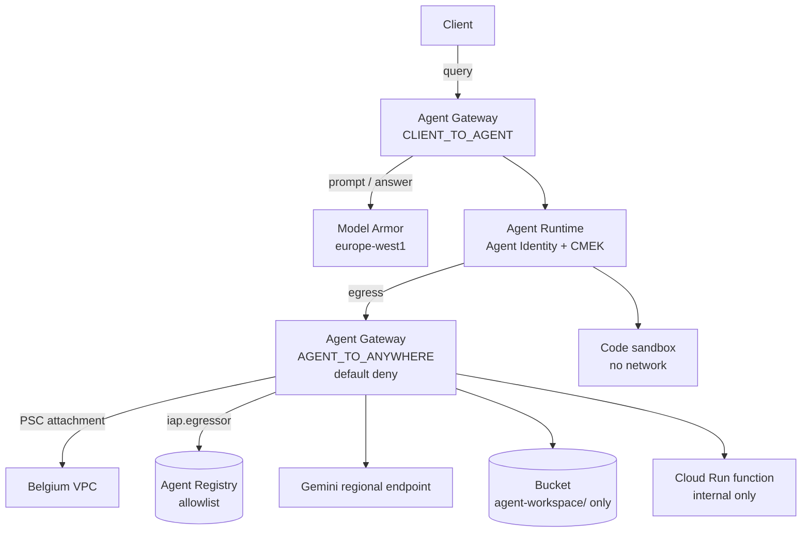
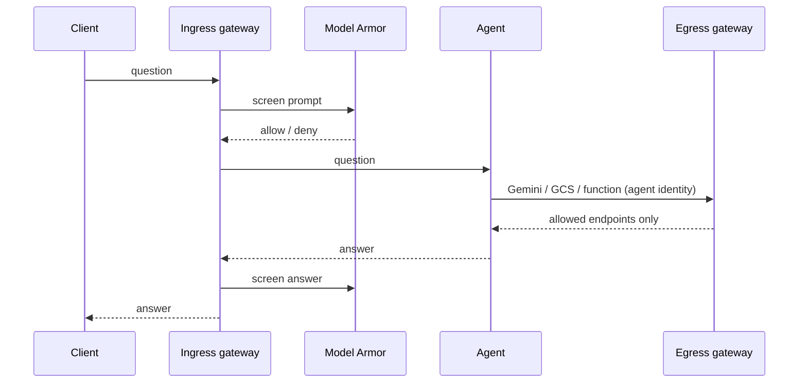

# 🛡️ geap-agent-secured — governed agent on Agent Runtime

Terraform documentation: [TFDOCS.md](TFDOCS.md)

An ADK agent on **Agent Runtime** that answers a simple question, reads and writes **one path** of a bucket, triggers a **Cloud Run function** and runs code in a **sandbox**. Every flow is governed: two **Agent Gateways**, **Model Armor** on the way in and out, **Agent Identity**, an **IAM egress allowlist** and a private attachment to the Belgium VPC.

> [!WARNING]
> This sample provisions billable resources (two Agent Gateways, Agent Runtime, Model Armor). Read the FinOps section, then run `task destroy` after a demo.

## ✨ Features

- Agent Identity, CMEK, `europe-west1` only.
- Ingress gateway (`CLIENT_TO_AGENT`) with Model Armor screening prompts and answers.
- Egress gateway (`AGENT_TO_ANYWHERE`), **default deny**: only endpoints registered in Agent Registry and granted `roles/iap.egressor` are reachable.
- Bucket access restricted to the `agent-workspace/` managed folder.
- Backend Cloud Run function (internal ingress, dedicated service accounts, no role).
- Sandboxed code execution (hermetic, no network) through `AgentEngineSandboxCodeExecutor`.
- Agent reaches the Belgium VPC through the egress gateway (Private Service Connect attachment).
- Optional semantic governance policy (Preview).

## 🧭 Architecture





### Key Design Decisions

| Decision | Choice | Why |
|---|---|---|
| Gateways | Two, one per governed access path | `CLIENT_TO_AGENT` and `AGENT_TO_ANYWHERE` are distinct modes ([ADR 004](../../docs/adr/004-dual-agent-gateway.md)) |
| Model Armor | Enforced at the ingress gateway (authz extension + `CONTENT_AUTHZ` policy), fail closed | No guardrail code in the agent ([ADR 003](../../docs/adr/003-model-armor-at-gateway.md)) |
| Bucket scope | Managed folder + `objectUser` | IAM conditions do not restrict object listing; agent identities cannot hold `legacyBucket*` roles |
| Function trigger | HTTPS call with an ID token through the egress gateway | Shows registry + `iap.egressor` allowlisting |
| Sandbox | `AgentEngineSandboxCodeExecutor` on the agent's own engine | No Terraform cycle; disabled with a warning if the engine cannot be resolved |
| VPC attachment | Through the egress gateway connectivity template | The API forbids a direct PSC interface on an engine that uses an Agent Gateway |
| Egress policy | `google_agent_registry_service` + `google_iap_agent_registry_endpoint_iam_member` | Everything is Terraform ([ADR 001](../../docs/adr/001-terraform-first-mechanism-matrix.md)) |
| Semantic governance | Opt-in flag, Preview | Billed per LLM evaluation; not default |

## 🔒 Security Design

| Control | Implementation |
|---|---|
| Identity | `AGENT_IDENTITY`, no service account, no key |
| Least privilege | Project roles: `aiplatform.user`, `logging.logWriter`. Bucket: `objectUser` on the managed folder only. Function: `run.invoker` on that function only |
| Prompt / answer screening | Model Armor (prompt injection, jailbreak, malicious URL, RAI, SDP) at the ingress gateway |
| Egress | Default deny; explicit allowlist in `registry.tf` (exact hostnames, standard and mTLS) |
| Data at rest | One CMEK key (bucket, function, agent) |
| Network | VPC access through the egress gateway PSC attachment (/28 subnet); function `ALLOW_INTERNAL_ONLY`; no NAT, no public IP |
| Sovereignty | `region` validated to `europe-west1`; model calls pinned to the regional endpoint (`config.py` rejects any other location) |
| Defence in depth | Tool-level path scoping on top of IAM; payload and file size limits |

> [!IMPORTANT]
> Preview surfaces (Agent Gateway, Agent Registry, semantic governance) and a few runtime behaviours could only be verified at deployment time. See "To validate at first apply" below.

## 💰 FinOps

| Item | Estimate | Cheaper option |
|---|---|---|
| Agent Gateways ×2 | Not published in the sources used for this sample — check the pricing page before applying | One gateway only drops either governed ingress or governed egress |
| Agent Runtime | vCPU/GiB-hours while an instance is up | `min_instances = 0` |
| Model Armor | Free monthly allotment, then per volume | Keep templates as is |
| Cloud Run function, GCS, KMS | Cents for a demo | — |
| Semantic governance | LLM call per evaluation | Off by default |

> [!TIP]
> Destroy the stack after each session: the gateways are the fixed cost of this sample.

## 📋 Prerequisites

`task setup` at the root, `gcloud auth application-default login`, `task bootstrap`, `task base:apply` (the CMEK key, the VPC and the Docker repository come from `samples/base`).

## 🚀 Deployment

```bash
task setup      # venv + pinned dependencies
task test       # offline Python + Terraform tests (no credentials)
task plan       # packages the agent, then terraform plan
task apply      # billable, no confirmation prompt
task invoke -- "Write 'hello' in agent-workspace/hello.txt then read it back"
task e2e        # optional end-to-end checks against the deployed agent (billable)
```

### To validate at first apply

| Point | What to check |
|---|---|
| CMEK on the agent engine | The Agent Runtime service agent can use the key (granted in `samples/base`); if the apply fails on the key, re-run once the service agent exists |
| Egress registry model | Registered services of type endpoint appear as registry endpoints (`data.google_agent_registry_endpoint`); adjust the filter if the display name differs |
| Function call from the agent | Agent Identity can mint an ID token for the function URL (`GOOGLE_API_PREVENT_AGENT_TOKEN_SHARING_FOR_GCP_SERVICES`); the internal-only function is reachable through the egress gateway |
| Sandbox | The platform injects `GOOGLE_CLOUD_AGENT_ENGINE_ID`, otherwise set `AGENT_ENGINE_RESOURCE_NAME` |
| VPC attachment | The API rejects `psc_interface_config` together with `agent_gateway_config` (confirmed at first apply): the VPC is reached through the egress gateway attachment only |
| Model availability | The model in `var.model` is served by the `europe-west1` regional endpoint |

### Semantic governance wiring (optional)

`enable_semantic_governance = true` creates the policy engine and an agent-scope policy. Attaching the engine to the egress gateway needs the engine DNS hostname, which the provider does not expose: create the authz extension and the authz policy as described in the [semantic governance guide](https://docs.cloud.google.com/gemini-enterprise-agent-platform/govern/policies/configure-semantic-governance) (policy on `:generateContent` and `:streamGenerateContent` only, start in `DRY_RUN`). It cannot be combined with Model Armor on the ingress gateway, hence the egress attachment.

## 🧰 Task Commands

| Command | Description |
|---|---|
| `task setup` / `task lock` | Create `.venv` / re-compile pinned requirements |
| `task package` | Build the deterministic agent archive |
| `task plan` / `task apply` / `task destroy` | Terraform lifecycle (`destroy` asks for confirmation) |
| `task invoke -- "<question>"` | Query the deployed agent |
| `task e2e` | Billable end-to-end checks (excluded from CI) |
| `task test` | Offline Python and Terraform tests |
| `task lint` | ruff and pyright |

## 🗂️ Project Structure

```text
samples/geap-agent-secured/
├── app/                  # archive root: agent.py, tools.py, config.py, logger.py, requirements.txt
├── function_src/         # Cloud Run function (main.py, requirements.txt)
├── scripts/              # package.py, invoke.py
├── tests/                # pytest, secured.tftest.hcl, fixtures/, e2e/ (excluded from CI)
├── main.tf  backend.tf  variables.tf  outputs.tf
├── storage.tf            # bucket + agent-workspace/ managed folder
├── function.tf           # Cloud Run function + dedicated service accounts
├── network.tf            # PSC network attachments
├── model_armor.tf        # templates + authz extension + CONTENT_AUTHZ policy
├── gateway.tf            # ingress and egress Agent Gateways
├── agent.tf  iam.tf      # Agent Runtime engine and least-privilege grants
├── registry.tf  policies.tf  # egress allowlist, IAM agent policies, semantic governance
└── Taskfile.yml
```
