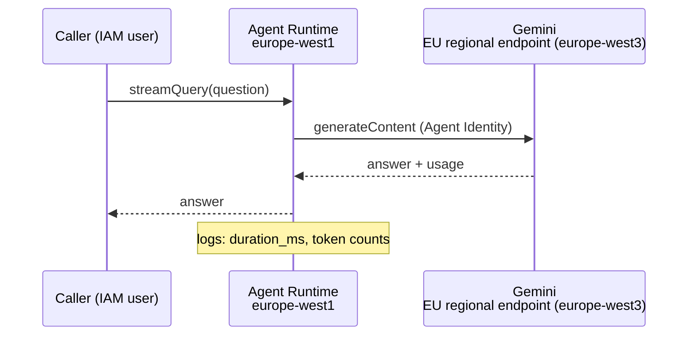

# 🤖 geap-agent-simple — ADK agent on Agent Runtime

Terraform documentation: [TFDOCS.md](TFDOCS.md)

The smallest GEAP sample: an ADK agent deployed on **Agent Runtime** that takes a simple question and sends it to a Gemini model. It shows the baseline used by [`geap-agent-secured`](../geap-agent-secured/README.md): Agent Identity, CMEK and the Belgium region.

## ✨ Features

- ADK `LlmAgent` without tools; agent in `europe-west1`, model served by the regional endpoint of an EU region (`model_location`, `europe-west3` by default for `gemini-3.5-flash`).
- Deployed from source by Terraform (`source_code_spec` + `python_spec`): no container to build.
- **Agent Identity** (no service account, no key) with two roles only.
- Engine encrypted with the shared CMEK key from `samples/base`.
- Token usage and duration logged for every LLM call; transient model errors retried by the client.

## 🧭 Architecture



### Key Design Decisions

| Decision | Choice | Why |
|---|---|---|
| Deployment | Terraform `google_vertex_ai_reasoning_engine` from source | Single owner of the state; no Dockerfile needed (see [ADR 001](../../docs/adr/001-terraform-first-mechanism-matrix.md)) |
| Identity | `AGENT_IDENTITY` | No keys, SPIFFE-style identity ([ADR 002](../../docs/adr/002-agent-identity.md)) |
| Python runtime | 3.13 on Agent Runtime, 3.14 locally | 3.13 is the latest version Agent Runtime supports; the code is compatible with both |
| Retries | `HttpRetryOptions` on the Gemini client | Transient errors only, no extra retry layer |
| Scale | `min_instances = 0`, `max_instances = 2` | Cheapest; validation keeps the bill bounded |

## 🔒 Security Design

- `region` is locked to `europe-west1` by a `validation {}` block; `model_location` is restricted to EU member-state regions, both in Terraform and in `config.py` at start-up (`europe-west2`, `europe-west6` and the `eu` multi-region, which has no mTLS host, are refused).
- The agent identity only holds `roles/aiplatform.user` and `roles/logging.logWriter` (project level, the minimum to call Gemini and log).
- No secret anywhere: the agent uses its identity; configuration comes from environment variables.

> [!NOTE]
> Without an organization, the Agent Identity trust domain is `agents.global.proj-<PROJECT_NUMBER>.system.id.goog`. The principal is built from the `effective_identity` output, never hardcoded.

## 💰 FinOps

| Item | Estimate | Note |
|---|---|---|
| Agent Runtime | vCPU/GiB-hours while an instance is up | `min_instances = 0` scales to zero |
| Gemini | per token | Flash model, short answers |

> [!TIP]
> Run `task destroy` after a demo. Keep `min_instances = 0` unless cold starts matter.

## 📋 Prerequisites

`task setup` at the repository root, `gcloud auth application-default login`, `task bootstrap` and `task base:apply` done.

## 🚀 Deployment

```bash
task setup      # venv + pinned dependencies
task test       # offline Python + Terraform tests
task plan       # builds the archive, then terraform plan
task apply      # deploys the agent (no confirmation)
task invoke -- "What is the capital of Belgium?"
```

## 🧰 Task Commands

| Command | Description |
|---|---|
| `task setup` | Create `.venv` and install pinned dependencies |
| `task lock` | Re-compile `app/requirements.txt` from `requirements.in` |
| `task run` | Local ADK web UI (real model call) |
| `task package` | Build the deterministic archive |
| `task plan` / `task apply` / `task destroy` | Terraform lifecycle (`destroy` asks for confirmation) |
| `task invoke -- "<question>"` | Query the deployed agent |
| `task test` | Offline Python and Terraform tests |
| `task lint` | ruff and pyright |

## 🗂️ Project Structure

```text
samples/geap-agent-simple/
├── app/                  # archive root: agent.py, config.py, logger.py, requirements.txt
├── scripts/              # package.py (deterministic tar.gz), invoke.py
├── tests/                # pytest + agent.tftest.hcl (+ fixtures/agent_src.tar.gz)
├── main.tf  backend.tf  variables.tf  outputs.tf
├── agent.tf              # Agent Runtime engine
├── iam.tf                # least-privilege roles for the agent identity
├── requirements.in  requirements-dev.txt  pyproject.toml
└── Taskfile.yml
```
